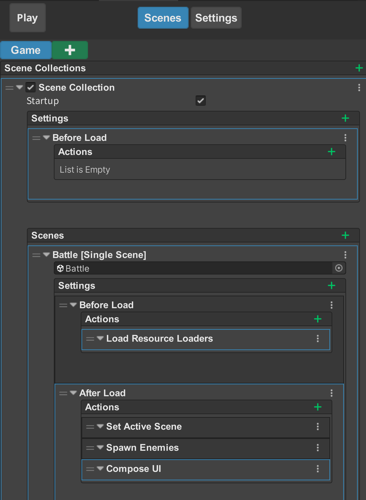
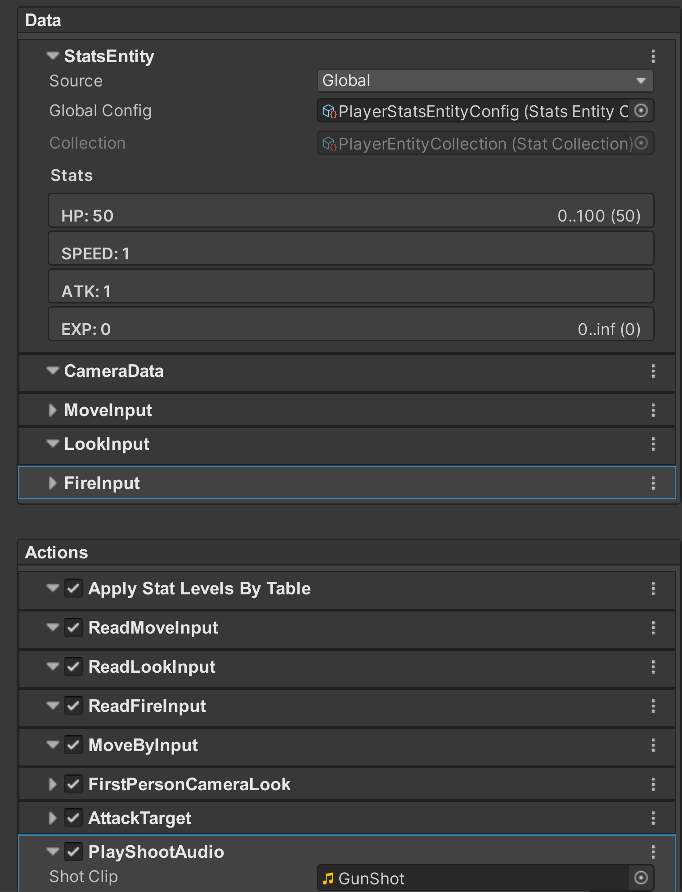
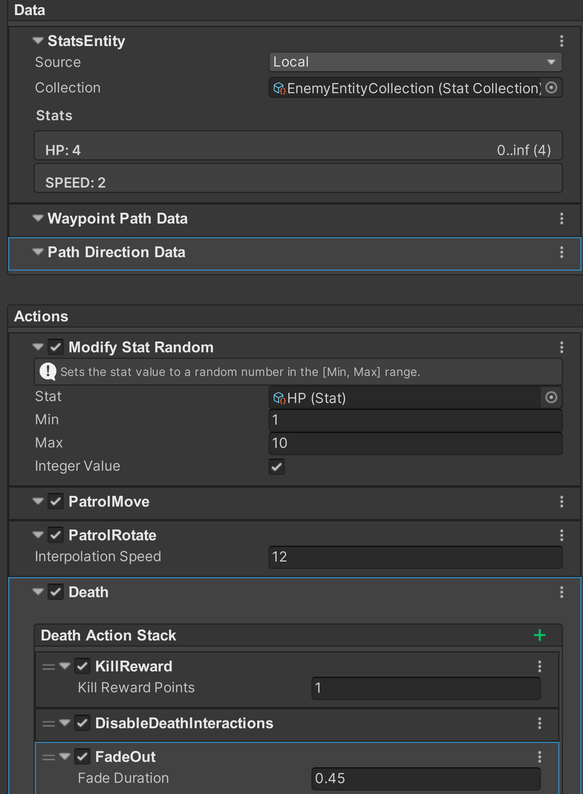
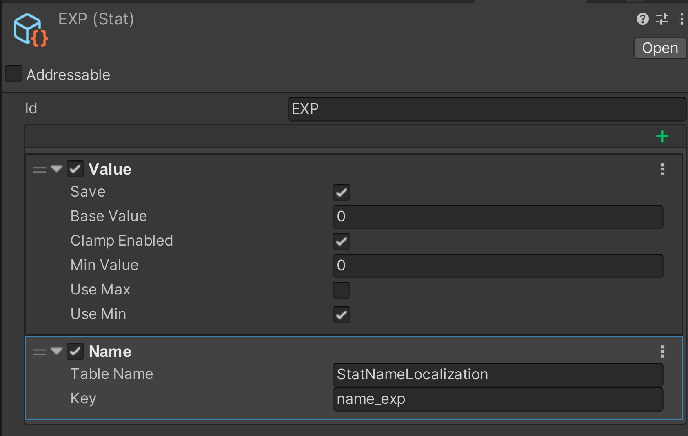
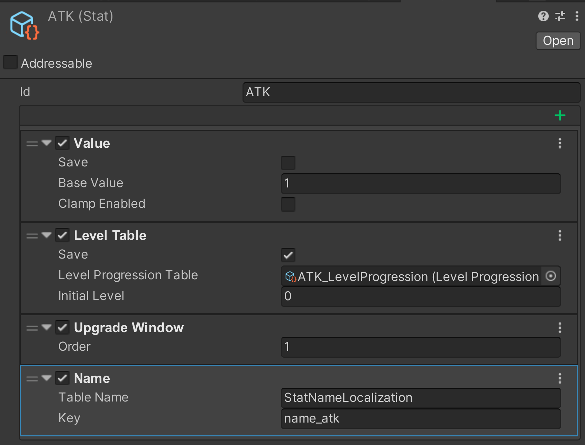
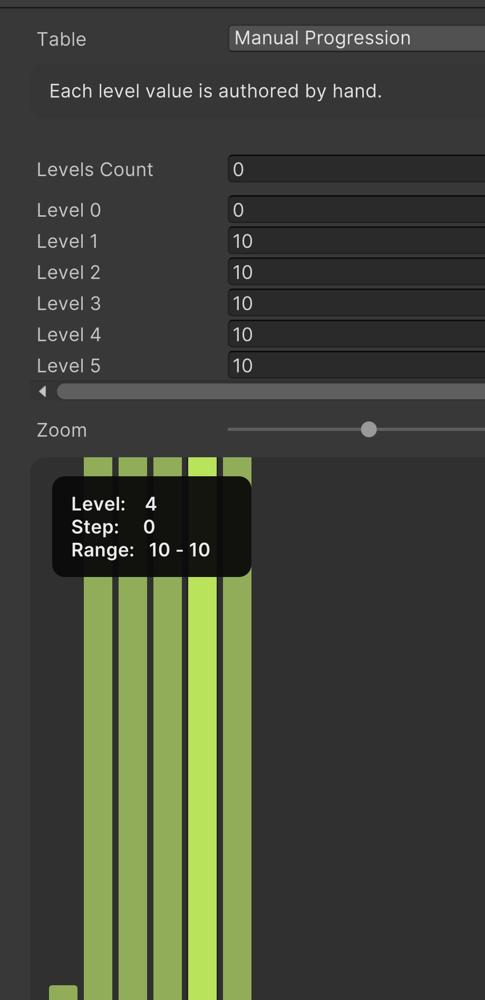
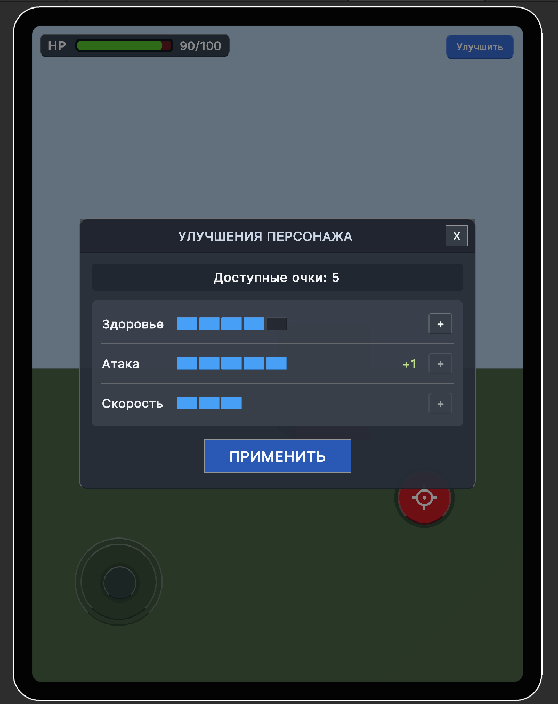
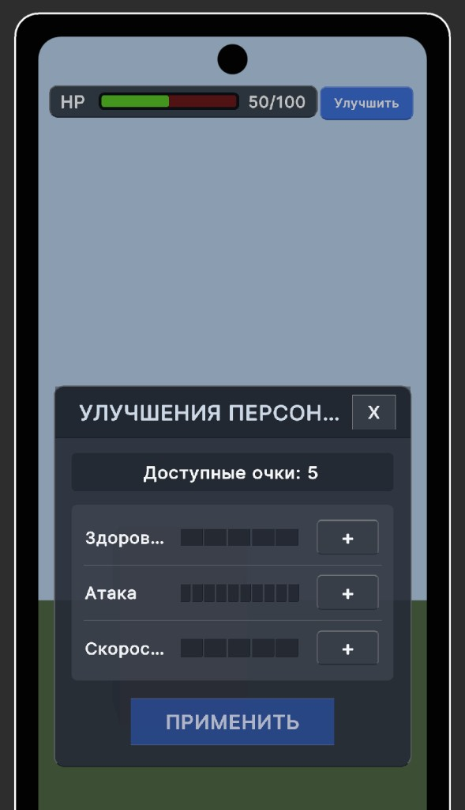
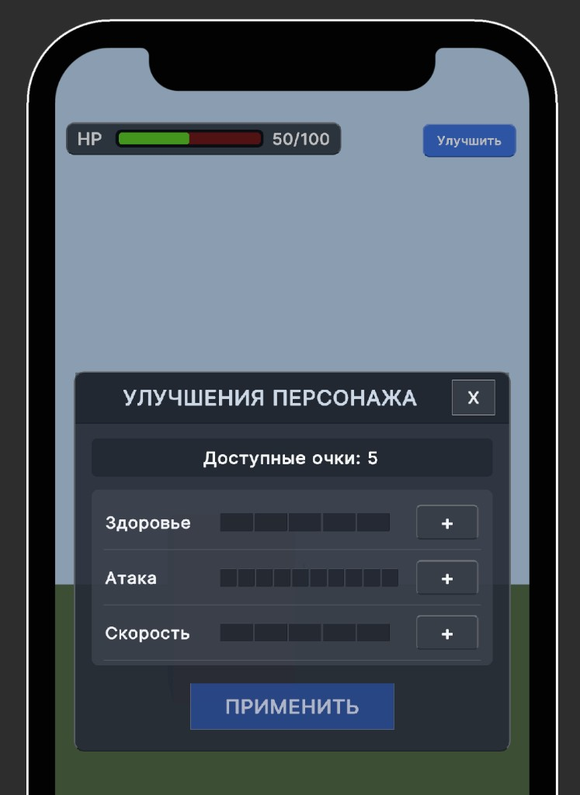

# Shooter Upgrade Prototype

- Gameplay video: https://youtu.be/uXD4HFMA-ck
- Build: https://drive.google.com/file/d/15z0wJ5YjUkUvmIg06pOqkqSFNOWz6S3l/view?usp=sharing

The video was recorded in the editor. In the build, the enemy shader responsible for the fade-out effect after death renders pink. The shader is included in the build and the issue does not appear in the editor. I tried rewriting it but did not have time to identify the cause.

## 1. Folder and Assembly Architecture

The project is organized around `Assets/Assemblies`, with every domain area extracted into a separate assembly.

Typical assembly structure:

- `Content` — scenes, prefabs, ScriptableObject configurations, and UI assets.
- `Runtime` — runtime code used by the game.
- `Editor` — editor tools and extensions.

### 1.1 Personal Frameworks Package

The project relies on my UPM package, `Packages/com.vladislavtsurikov.frameworks`, which contains the architecture's foundational building blocks.

### 1.2 asmdef Separation

Separate `asmdef` files keep module responsibilities distinct and make the project easier to extend.

- `ShooterUpgradePrototype` — the core gameplay module. It contains the player, enemies, UI, services, configurations, and runtime integration of domain logic.
- `Stats` — a reusable, extensible stats system used in several previous projects. It supports new stats without changing existing code, value modifiers, effects, buffs, and progression tables.
- `LevelProgression` — stores level tables, calculates cumulative values, and implements upgrades.
- `Input` — encapsulates the Input System and provides a unified data layer for gameplay logic.
- `InputMode` — abstracts desktop and mobile control differences and centrally manages the current input mode.
- `MobileInputUI` — visual mobile controls (joysticks and buttons) and their input-system integration.
- `FirstPersonCamera` — isolates first-person camera logic from gameplay so it is easier to replace or extend.
- `UIRootSystem` — integrates with `UISystem` and provides parent containers for screens, popups, and HUD layers. This approach scales to complex UI structures.
- `WaypointsSystem` — reused from another project to move enemies along paths and to support spawning them on those paths.
- `WaypointPathEntitySpawner` — reusable entity spawning on waypoint paths, with independently extensible path selection, capacity, and spawn-position rules.
- `ArmyClash.SceneManager` — a `SceneManagerTool`-based bootstrap integration module that loads resource loaders, binds configurations, and performs initial enemy spawning after the scene loads.

## 2. Technology Stack and Framework

- **Zenject** — used for dependency injection. Classes receive dependencies through the container instead of looking them up manually. It creates and binds services, input systems, spawners, bootstrap operations, and runtime configurations.
- **UniRx** — an optimization-oriented reactive tool: logic runs in response to events rather than continuously checking conditions in `Update`. It is used for input, states, stats, upgrades, and UI synchronization.
- **EntityDataAction** — the main gameplay approach. Behavior is composed from `ComponentData` and `Action`; entities use `EntityMonoBehaviour`, `ComponentData`, and `EntityMonoBehaviourAction`. Individual actions can be disabled to assess their impact, include debug blocks such as `OnDrawGizmos`, and be reused without deep inheritance or duplicated code. The trade-off is a higher file count.
- **UI Toolkit** — used for the UI.
- **AddressableLoaderSystem** — loads and binds configurations through Addressables before combat, automatically binds them in Zenject, and unloads them correctly. It also supports parallel batch loading. The project loads one configuration through it, but the system provides an architectural foundation.
- **SceneManagerTool** — the bootstrap entry point. `Play` runs a controlled startup pipeline with operations before and after scene loading; the ready-made implementation is highly extensible.
- **UISystem** — the MVP-based UI layer. Developers create a `UIPresenter`, assign it an optional parent, and form an interface tree with unlimited nesting. Initialization runs from top to bottom; child Presenters wait for their parent. UI can be opened externally or from other Presenters, and prefabs or `UIDocument`s can be loaded through Addressables.

## 3. Entry Point and Bootstrap Flow

Start the game in the editor using the `Play` button in the `Scene Manager` window:

- `Window -> Vladislav Tsurikov -> Scene Manager`

The tool is both a scene launcher and an extensible initialization point. It makes scene work and bootstrap management easier, allowing the initialization pipeline to grow without turning startup into a collection of unrelated calls.

The `SceneManager` pipeline performs the following operations:

- `BeforeLoad`: `LoadResourceLoadersOperation` loads required configurations and resource loaders before the target scene.
- `AfterLoad`: `SpawnEnemiesOperation` performs the initial enemy spawn up to `MaxMobCount`.

  

## 4. Data and Behavior Architecture

### 4.1 Entity Layer

The project has two gameplay entities, `PlayerEntity` and `EnemyEntity`. Neither contains a large controller: each creates a set of `ComponentData` and `Action` objects that compose its behavior.

### 4.2 Player

`PlayerEntity` creates:

- data: `StatsEntityData`, `CameraData`, `MoveInputData`, `LookInputData`, and `FireInputData`;
- actions: `ApplyStatLevelsByTableAction`, `ReadMoveInputAction`, `ReadLookInputAction`, `ReadFireInputAction`, `MoveByInputAction`, `DesktopFirstPersonCameraLookAction`, `MobileFirstPersonCameraLookAction`, `AttackTargetAction`, and `PlayShootAudioAction`.

The actions apply stat values from the progression table; read and store input; move the player from input and stats; rotate the camera for the relevant platform; handle shooting; and play its audio.

  

### 4.3 Enemies

`EnemyEntity` creates `StatsEntityData`, `WaypointPathData`, and `WaypointPathDirectionData`, then uses `ModifyStatRandomAction`, `PatrolMoveAction`, `PatrolRotateAction`, and `DeathAction`. These actions add stat variation, move an enemy along a waypoint path, keep rotation synchronized with movement, and handle death.

  

### 4.4 Why This Approach Was Chosen

The vacancy listed ECS experience as a major advantage. This is my first experience using this framework specifically for gameplay logic, and I wanted to broaden my understanding of this programming approach. It fits the assignment well because it is extensible. I had prior experience with `DOTS`, and had used this approach for complex `Unity UI Canvas` interfaces, where it helped reuse blocks of code and speed development.

In essence, this is an ECS approach. In classic ECS, behavior generally lives in a `System`, which is not configurable in the Inspector. Here that role is played by an `Action`, which can be configured directly in the Inspector. This speeds up composing logic within architectural boundaries, helps prevent duplication, and let me reuse part of the existing logic for the test assignment.

`ComponentData` can also become “dirty”: when an `Action` or external code changes data, a dependent `Action` is triggered automatically. This simplifies reactive behavior, works well for UI, and makes it possible to test parts of the logic in `EditMode` without entering `PlayMode`. Each `Action` can independently enable `OnDrawGizmos`, which is useful for debugging and tuning.

## 5. Stats and Configuration Architecture

The stats system was reused from a previously developed solution already applied in several projects. It is a separate extensible system: every stat is an entity; values support modifiers; effects and buffs can be added; and it integrates with `LevelProgression` tables.

### 5.1 Upgrade Points Through EXP

**`EXP`** is the upgrade-point stat:

- It is not a separate upgrades-window system; it is part of the common **Stats** system, alongside `HP`, `ATK`, and `SPEED`.
- It belongs to the player's stat set and is added to `PlayerEntity` through the shared `StatsEntityConfig`.
- The player gets `+1 EXP` for every enemy kill.
- The upgrades window reads available points from the current `EXP` value and deducts the required points from it when applying upgrades.

`EXP.asset` has `Save` enabled, so accumulated EXP persists between sessions using the same mechanism as other stat data.

  

Upgradeable attributes such as `ATK` use a separate `Level Table` with `Save` enabled. Therefore, the applied stat level—not only the current value—is saved.

  

### 5.2 Persistence Between Sessions

Progress is persisted at the stats-system level, rather than by a separate upgrades-window save manager. The project saves upgradeable stat levels (`HP`, `ATK`, `SPEED`) and the `EXP` value used as available upgrade points.

The **`Save`** field on a configured stat component enables persistence. Runtime data is restored on startup and written when the value changes.

- `RuntimeStatLevelData` stores a stat's **level** in `PlayerPrefs` under `{StatId}Level`.
- `RuntimeStatValueData` stores its **numeric value** in `PlayerPrefs` under `{StatId}Value`.

After restarting, upgraded levels and accumulated EXP are restored as the entity initializes.

### 5.3 Progression Tables

A progression table defines a stat's final value at every level. `HP`, `ATK`, and `SPEED` each use their own `LevelProgression` asset, so balance can be adjusted without code changes. The project uses `Manual Progression`: every level value is authored manually in the Inspector.

  

### 5.4 Project Configurations

- `EnemySpawnConfig.asset` — enemy respawn delay and maximum enemy count.
- `PlayerStatsEntityConfig.asset` — player stat set and initial values.
- Player stats: `ATK.asset`, `HP.asset`, `SPEED.asset`, and `EXP.asset` under `Assets/Assemblies/ShooterUpgradePrototype/Content/Configs/Stats/Player/`.
- Enemy stats: `HP.asset` and `SPEED.asset` under `Assets/Assemblies/ShooterUpgradePrototype/Content/Configs/Stats/Enemy/`.
- Player progression tables: `ATK_LevelProgression.asset`, `HP_LevelProgression.asset`, and `SPEED_LevelProgression.asset` under `Assets/Assemblies/ShooterUpgradePrototype/Content/Configs/LevelProgression/Player/`.
- Stat collections: `PlayerEntityCollection.asset` and `EnemyEntityCollection.asset` under `Assets/Assemblies/ShooterUpgradePrototype/Content/Configs/StatsCollections/`.

## 6. UI: Logic, Scaling, and Localization

### 6.1 UI Logic (UISystem + MVP)

The UI is built with **UISystem** + **UI Toolkit** and follows MVP:

- **Presenter (Handler)** manages the UI lifecycle, subscriptions, and data. For example, `BattleHUDRootPresenter` creates the HUD in `RootSlots.HudRoot`; `UpgradeWindowPresenter` opens the upgrades window, blocks gameplay input, creates dynamic stat rows, and applies pending upgrades.
- **View** is a `BindableVisualElement` (or `Button` descendant) that holds UXML-element references, forwards click events, and updates the visual state. `UpgradeWindowView` contains Apply/Close controls, backdrop, title, and localized text; `UpgradeStatRowView` contains a stat name, level segments, delta, and `+` button.
- **LayoutLoader** addressably loads UXML/USS by addresses such as `BattleHUD` and `UpgradeWindow`.

### 6.2 UI Toolkit Scaling and Responsiveness

  
  
  

### 6.3 Localization

Unity 2022.3 does not offer equally convenient out-of-the-box Unity Localization text binding for **UI Toolkit** and `Unity UI`. Therefore, localization is implemented **in View code**:

- even **static** elements such as titles and buttons are assigned from `LocalizationSettings.StringDatabase` during View initialization;
- it uses the `UILocalization` table and keys such as `upgrade.window.title`, `upgrade.window.apply`, and `hud.open-upgrade`.

This is **not ideal**; declarative binding at the UXML/localized-component level would be preferable.

## 7. Desktop and Mobile Input Support

The two input modes use a shared input pipeline with different sources rather than separate gameplay branches.

### 7.1 Shared Design

One `InputActionAsset`, `PlayerInputActions`, defines `Move`, `Look`, and `Fire`. Each has two binding groups: `Desktop` and `Mobile`.

- `Desktop` uses `Keyboard + Mouse`.
- `Mobile` uses `Touchscreen` and optionally `Gamepad`.

On desktop, movement uses `WASD`, looking uses `Mouse delta`, and firing uses the left mouse button. On mobile, movement uses `Gamepad leftStick`; looking uses `Touchscreen primaryTouch delta` and `Gamepad rightStick`; firing uses `Gamepad buttonSouth`.

### 7.2 Why InputModeService Is Needed

`InputModeService` detects the device type currently used by the player. It distinguishes `KeyboardMouse`, `Gamepad`, and `Touch`. It does not read input values itself; instead, it exposes the current **input mode** so other systems can adapt their UI and gameplay behavior.

- On PC, using keyboard or mouse selects `KeyboardMouse`.
- Pressing a physical gamepad control switches to `Gamepad`.
- Using keyboard or mouse again switches back to `KeyboardMouse`.
- On mobile, the default is `Touch`; a connected physical gamepad that is actively used takes priority as `Gamepad`.

### 7.3 Desktop and Mobile Modes

Both modes use the shared `Input System`. Desktop reads keyboard and mouse directly through `PlayerInputActions`. Mobile adds `MobileInputUI` with a virtual stick and fire button.

Both flows converge into the same gameplay pipeline: input becomes unified player data consumed by movement, camera, and shooting. Gameplay code is therefore not duplicated. The mobile HUD appears only when the active `InputMode` is `Touch`, so the desktop and mobile interfaces do not overlap.

### 7.4 How Mobile UI Reaches Gameplay Input

The mobile UI does not write directly to gameplay. It emulates a virtual device via `MobileVirtualInputService`, and input then travels through the same `Input System` used by desktop controls. This keeps one input-reading pipeline for every mode.

### 7.5 Why the Camera Works on Both Desktop and Mobile

The camera uses a single `FirstPersonCameraLookAction`. Desktop and mobile do not have separate gameplay systems: the difference remains at the input-data level, while camera-rotation logic is shared. This avoids duplicated camera gameplay code while supporting multiple control modes.
